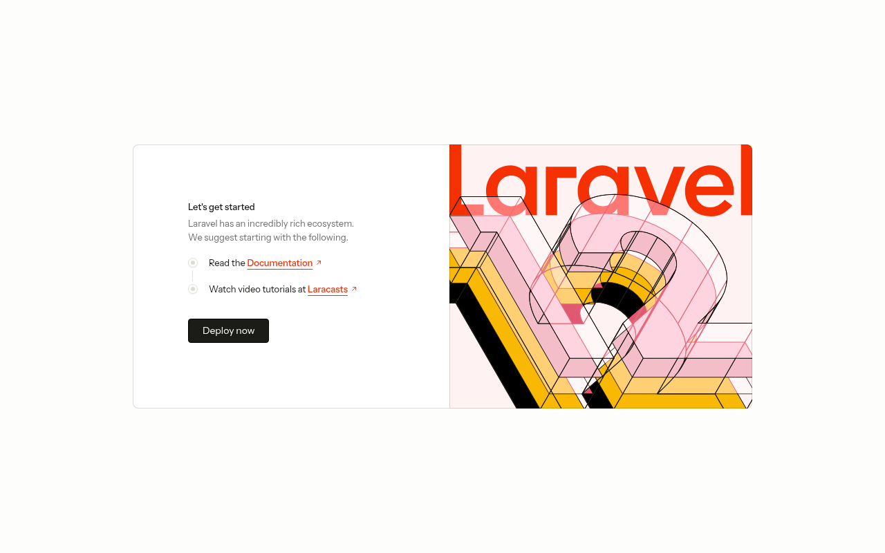

# Web Kelola Tiket

Web Kelola Tiket adalah backend API untuk aplikasi pengelolaan tiket bantuan. Pengguna terdaftar dapat membuat tiket dan menulis balasan pada tiket. Sisi server menyediakan endpoint autentikasi, data statistik dashboard, dan pengelolaan tiket dalam format JSON. Repositori ini berisi kode backend saja. Frontend terpisah tidak disertakan.

## Fitur

- Registrasi dan login pengguna dengan token Laravel Sanctum
- Endpoint profil pengguna yang sedang login dan logout
- Daftar tiket dengan pencarian dan filter
- Detail tiket berdasarkan kode tiket
- Buat tiket baru dengan validasi form request
- Balasan tiket oleh pengguna
- Statistik jumlah tiket untuk dashboard
- Response API terstruktur memakai API Resource

## Teknologi

- PHP 8.2
- Laravel 12
- Laravel Sanctum
- MySQL
- Vite dan Tailwind CSS untuk aset bawaan

## Cara Instalasi

Prasyarat:

- PHP 8.2 atau lebih baru
- Composer
- MySQL

Langkah instalasi:

1. Clone repositori ini.
2. Masuk ke folder proyek lalu jalankan `composer install`.
3. Salin file `.env.example` menjadi `.env`, lalu sesuaikan isinya. Bagian penting adalah `APP_KEY` dan koneksi database `DB_CONNECTION`, `DB_HOST`, `DB_PORT`, `DB_DATABASE`, `DB_USERNAME`, `DB_PASSWORD`. Nama database bawaan pada `.env.example` adalah `api_tick_track`.
4. Jalankan `php artisan key:generate`.
5. Jalankan `php artisan migrate`.

## Cara Menjalankan

```bash
php artisan serve
```

API berjalan di `http://127.0.0.1:8000`. Endpoint utama berada pada grup autentikasi, tiket, dan balasan tiket.

## Catatan Kelengkapan Repositori

Kerangka aplikasi sudah dilengkapi mengikuti kerangka standar Laravel 12. Berkas yang ditambahkan meliputi file `artisan`, folder `bootstrap`, folder `routes` untuk web dan API, migration tabel users, cache, jobs, personal access tokens, tickets, dan ticket_replies, factory dan seeder bawaan, `AppServiceProvider`, serta dua API Resource yang dirujuk controller yaitu `UserResource` dan `TicketResource`. Kolom `role` ditambahkan pada tabel users karena dipakai oleh model dan controller. Proyek sudah diverifikasi dapat dijalankan dari hasil clone dengan mengikuti langkah instalasi di atas. Pengujian lokal memakai sqlite dengan mengatur `DB_CONNECTION=sqlite` pada file `.env`, sedangkan `.env.example` tetap memakai MySQL sesuai konfigurasi awal proyek. Seluruh endpoint utama sudah diuji dan berfungsi, meliputi registrasi, login, profil, logout, daftar dan detail tiket, pembuatan tiket, balasan tiket, dan statistik dashboard.

## Tangkapan Layar



## Lisensi

Proyek ini memakai lisensi MIT. Lihat berkas [LICENSE](LICENSE).
